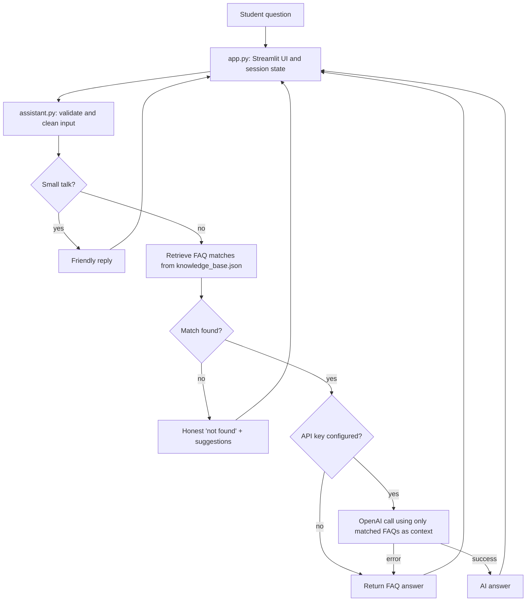

# 🎓 CampusAI: Your Smart Campus Companion

A web-based assistant that answers common campus questions (attendance, exams, library, scholarships, placements...) from an editable FAQ knowledge base. It works fully offline in **FAQ-only mode**, and can optionally use the **OpenAI API** to phrase answers naturally, grounded strictly in the matched FAQs.

> **Demo data notice:** the bundled knowledge base is fictional sample content for a made-up "Demo College of Engineering". It is not from any real institution. Replace it with your own college's verified information.

## Problem statement
Students repeatedly search notice boards, portals and PDFs, or ask staff, for routine information. CampusAI gives one place to ask in plain language, and it says "I don't know" instead of inventing policies.

## Features
- Chat interface with session history, loading indicator, suggested and quick-access questions, and a clear-chat button
- Related-question suggestions after each answer
- Browse FAQs by category; knowledge-base status indicator in the sidebar
- Keyword matching with synonyms, light stemming and typo tolerance
- Honest "not found" response (the AI is **not** called when nothing relevant matches)
- Optional AI answers with guardrails; automatic fallback to the FAQ answer on any API error
- Input validation and exception handling so the UI does not crash

## Tech stack
Python 3.10+ · Streamlit · OpenAI Python SDK (optional) · JSON knowledge base · `unittest` · Git/GitHub · Streamlit Community Cloud

## Architecture and data flow


**Matching algorithm (`KnowledgeBase.search`):** each question is tokenised (stop words removed, synonyms mapped, light stemming). Each FAQ is scored by token overlap using weights (curated keywords > question text > category > answer text) multiplied by an IDF factor so rare words count more, plus a bonus when a whole keyword phrase appears. Entries below a threshold are discarded.

## Project structure
```
CampusAI/
├── app.py                  # Streamlit UI + session state
├── assistant.py            # validation, retrieval, optional AI, error handling
├── knowledge_base.json     # editable demo FAQs
├── requirements.txt
├── .env.example
├── .gitignore
├── .streamlit/config.toml  # theme (accessible contrast)
├── tests/test_assistant.py
└── README.md
```

## Run locally
```bash
git clone <your-repo-url> && cd CampusAI
python -m venv .venv
source .venv/bin/activate          # Windows: .venv\Scripts\activate
pip install -r requirements.txt
streamlit run app.py
```
Open http://localhost:8501. With no key configured it starts in FAQ-only mode.

## Enable AI answers (optional)
```bash
cp .env.example .env               # Windows: copy .env.example .env
# edit .env and set OPENAI_API_KEY=your-own-key
```
Never commit `.env` (it is in `.gitignore`). `OPENAI_MODEL` can override the default model.

## Run the tests
```bash
python -m unittest discover -s tests -v
```
The tests need no network or API key (the OpenAI client is replaced by a fake).

## Customise the knowledge base
Edit `knowledge_base.json`. Each entry needs `id`, `category`, `question`, `answer`; `keywords` and `related` (list of ids) are optional but improve matching. Add the phrasings students actually use as keywords. Press **Reload knowledge base** in the sidebar after editing.

## Deploy on Streamlit Community Cloud
1. Push the repo to GitHub (public, or grant Streamlit access to a private repo).
2. Go to https://share.streamlit.io, sign in with GitHub and choose **Create app**.
3. Select the repository and branch, and set the main file to `app.py`.
4. Optional AI mode: in **Advanced settings → Secrets** add `OPENAI_API_KEY = "your-own-key"`.
5. Deploy, then test the app using the checklist below.

## Manual test checklist
- [ ] App starts with no API key; sidebar shows "FAQ-only mode" and KB "Loaded · 16 FAQs · 8 categories"
- [ ] Click a suggested question: answer appears with category caption
- [ ] "What time does the library open?", "library timings" and "libary hours" (typo) all return the library hours FAQ
- [ ] "Am I detained if my attendance is low?" returns the attendance FAQ
- [ ] "What is the capital of France?" gets an honest "couldn't find that" reply
- [ ] Empty submit does nothing; a 500+ character question is blocked
- [ ] Related-question buttons work; **Clear chat** empties history
- [ ] Browse FAQs and About pages open; disclaimer is visible
- [ ] Temporarily rename `knowledge_base.json`: friendly error, no crash; rename back and reload
- [ ] With an invalid key set: FAQ answer shown with a warning notice
- [ ] With a valid key: answers are short, based on FAQ content, and say when info is missing

## Limitations
- Demo data only; keyword matching can miss unusual phrasings or questions that mix topics
- No semantic search, login, per-student data, or persistent chat history
- AI answers can still be wrong; the prompt reduces but does not eliminate this
- The app has not been load-tested or security-audited

## Future improvements
Embedding-based retrieval, admin page for editing FAQs, multilingual support, feedback buttons to find missing FAQs, and logging of unanswered questions (with privacy safeguards).
